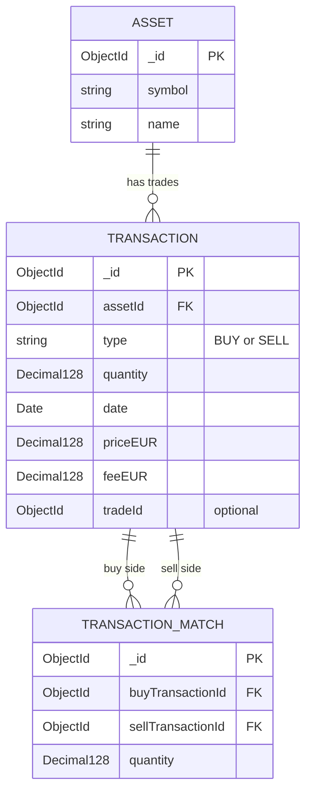
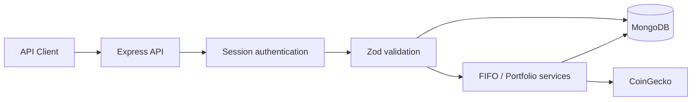

# Crypto Portfolio REST API

A backend MVP for tracking cryptocurrency trades, viewing portfolio holdings in EUR, and calculating realized gains and losses using **FIFO** (first in, first out).

Built as a learning project with **Node.js, Express, MongoDB, Mongoose, Decimal.js, Zod, and CoinGecko**.

## Features

- Asset and BUY/SELL transaction management (REST CRUD)
- Portfolio holdings and EUR valuation using live CoinGecko prices
- FIFO cost basis, transaction fees, realized profit/loss, and simplified one-year holding-period classification
- Single-admin login with MongoDB-backed sessions
- Request validation, protected routes, CORS, security headers, and login rate limiting
- Jest and Supertest testing setup

## Getting started

Requires **Node.js** and a **MongoDB deployment supporting transactions** (for example, MongoDB Atlas).

```bash
npm install
```

Create a `.env` file in the project root:

```dotenv
PORT=3000
MONGODB_URI=your_mongodb_connection_string
SESSION_SECRET=your_long_random_secret
ADMIN_USERNAME=admin
ADMIN_PASSWORD_HASH=your_bcrypt_password_hash
CLIENT_ORIGIN=http://localhost:5173
```

Keep `.env` private and out of Git. `ADMIN_PASSWORD_HASH` must be a **bcrypt hash**, not a plaintext password.

```bash
npm start
npm test
```

The API runs at `http://localhost:3000` by default. Authenticate through the login endpoint before calling protected routes; clients must retain the session cookie.

## API endpoints

All endpoints below are prefixed with `/api`.

| Method | Endpoint | Purpose |
| --- | --- | --- |
| POST | `/auth/login` | Start a session |
| POST | `/auth/logout` | End a session |
| GET, POST | `/assets` | List or create assets |
| GET, PATCH, DELETE | `/assets/:id` | Read, update, or delete an asset |
| GET, POST | `/transactions` | List or create transactions |
| GET, PATCH, DELETE | `/transactions/:id` | Read, update, or delete a transaction |
| GET | `/portfolio/holdings` | Calculate quantities held |
| GET | `/portfolio/value` | Get current EUR portfolio valuation |
| POST | `/portfolio/fifo` | Recalculate and persist FIFO matches |

Asset, transaction, and portfolio endpoints require authentication. FIFO recalculation replaces previously saved matches; changes to transactions invalidate those matches until recalculation.

## Data model

MongoDB collections use references rather than SQL foreign-key constraints. A FIFO match connects one BUY transaction to one SELL transaction.



### Request flow



## Scope and limitations

This is a **single-admin educational MVP**, not a trading platform or tax-filing tool. Holding-period classification is simplified and is **not tax advice**. Live valuations depend on CoinGecko availability. CSV imports and deployment are outside the current MVP scope.
