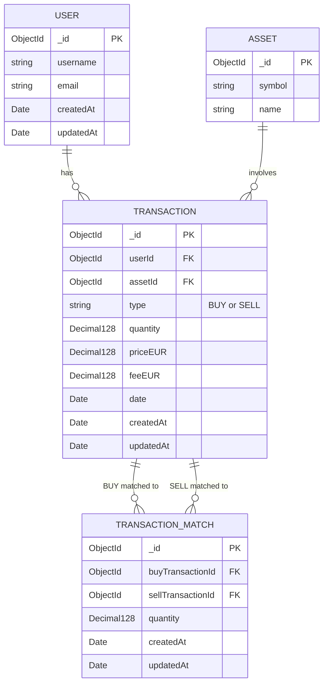

1. Project setup
   [x] Initialize Git and connect GitHub
   [x] Initialize Node.js project and install Express
   [x] Create a working Express server and first GET endpoint
   [x] Set up .gitignore and environment variables
   [x] Organize the project folder structure

2. API planning & database design
   [x] Define the MVP and supported transaction types
   [x] Choose the data models and their relationships
   [x] Create an ERD or equivalent diagram
   [x] Plan REST endpoints and example JSON responses

3. MongoDB & Mongoose
   [x] Understand MongoDB collections, documents and schemas
   [x] Connect the application to MongoDB
   [x] Create the database models and relationships

4. Core REST API
   [x] Implement transaction CRUD endpoints
   [x] Add request validation and error handling
   [x] Implement filtering and sorting
   [x] Calculate portfolio holdings from transactions

5. External API communication
   [x] Understand HTTP requests between APIs
   [x] Choose a cryptocurrency price provider
   [x] Fetch and process current cryptocurrency prices
   [x] Handle external API failures

6. Portfolio & FIFO calculations
   [x] Understand and integrate Decimal.js for precise financial calculations.
   [x] Calculate acquisition costs including fees
   [x] Implement FIFO for partial and multiple sales
   [x] Calculate realized profits and losses
   [x] Add simplified German holding-period classification
   [x] Flag incomplete or inconsistent transaction histories

7. Security
   [x] Decide on authentication and authorization
   [x] Protect private endpoints
   [x] Configure CORS and rate limiting
   [x] Add appropriate security headers and safe error responses

8. Testing with Jest
   [ ] Test CRUD endpoints and validation
   [ ] Test FIFO calculations with known examples
   [ ] Test authentication and error cases
   [ ] Test external API communication with mocked responses

9. Documentation & deployment
   [ ] Write README with setup instructions
   [ ] Document endpoints, requests and responses
   [ ] Deploy the API with HTTPS
   [ ] Verify deployed endpoints and submit GitHub and live URLs

10. Optional extensions
    [ ] Import Binance transactions from CSV
    [ ] Detect duplicate imports
    [ ] Generate annual portfolio or tax summaries

## Minimum Viable Product (MVP)

The **Crypto Portfolio API** is a REST API that allows users to track cryptocurrency transactions and calculate the current value of their portfolio.

### 1. Transaction Management

The API supports two transaction types: `BUY` and `SELL`.

Users can perform the following CRUD operations:

| Method | Endpoint            | Description                          |
| ------ | ------------------- | ------------------------------------ |
| GET    | `/transactions`     | Retrieve all transactions            |
| GET    | `/transactions/:id` | Retrieve a transaction by ID         |
| POST   | `/transactions`     | Create a new BUY or SELL transaction |
| PATCH  | `/transactions/:id` | Update an existing transaction       |
| DELETE | `/transactions/:id` | Delete a transaction                 |

Transactions are stored persistently in **MongoDB**.

### 2. Live Cryptocurrency Prices

The API communicates with an external cryptocurrency price API to retrieve current market prices in **EUR**.

### 3. Portfolio Holdings and Valuation

The API calculates the user's cryptocurrency holdings based on recorded BUY and SELL transactions.

For each cryptocurrency, it provides:

- Total quantity currently held
- Current market price in EUR
- Current value of the holdings in EUR

The API also calculates the **total portfolio value in EUR**.

### 4. Scope

The MVP focuses on transaction management and current portfolio valuation.

The following features are planned for later development:

- FIFO cost-basis and realized profit/loss calculations
- Simplified German tax holding-period classification
- Binance CSV transaction imports

## ERD



## REST API Endpoints

### Transaction Management

| Method | Endpoint            | Description                          |
| ------ | ------------------- | ------------------------------------ |
| GET    | `/transactions`     | Retrieve all transactions            |
| GET    | `/transactions/:id` | Retrieve a transaction by ID         |
| POST   | `/transactions`     | Create a new BUY or SELL transaction |
| PATCH  | `/transactions/:id` | Update an existing transaction       |
| DELETE | `/transactions/:id` | Delete a transaction                 |

### Live Cryptocurrency Prices

| Method | Endpoint                | Description                                        |
| ------ | ----------------------- | -------------------------------------------------- |
| GET    | `/assets/:symbol/price` | Retrieve the current EUR price of a cryptocurrency |

Example: `GET /assets/BTC/price`

### Portfolio

| Method | Endpoint     | Description                                                               |
| ------ | ------------ | ------------------------------------------------------------------------- |
| GET    | `/portfolio` | Retrieve current cryptocurrency holdings and total portfolio value in EUR |

## MongoDB vs. PostgreSQL

| Feature             | PostgreSQL                                 | MongoDB                                                           |
| ------------------- | ------------------------------------------ | ----------------------------------------------------------------- |
| Database type       | Relational (SQL)                           | Document-oriented (NoSQL)                                         |
| Data storage        | Tables                                     | Collections                                                       |
| Individual records  | Rows                                       | Documents                                                         |
| Data structure      | Columns defined by a schema                | Fields in BSON documents                                          |
| Schema              | Typically predefined and enforced          | Flexible; validation can be added                                 |
| Primary key         | Usually `id`                               | Usually `_id`                                                     |
| Relationships       | Foreign keys and JOINs                     | References or embedded documents                                  |
| Query language      | SQL                                        | MongoDB Query Language (MQL)                                      |
| Transactions        | Supports ACID transactions                 | Supports ACID transactions, including multi-document transactions |
| Node.js integration | Prisma, `pg`, etc.                         | Mongoose, MongoDB Node.js driver                                  |
| Data validation     | Database constraints                       | MongoDB schema validation and/or Mongoose validation              |
| Best suited for     | Structured data with complex relationships | Flexible document structures and document-oriented applications   |

### Key Concepts

- **MongoDB** is the database system.
- **Mongoose** is an ODM (Object Document Mapper) for Node.js.
- **Schema:** Defines the structure and validation rules of documents in Mongoose.
- **Model:** Provides methods to interact with a MongoDB collection.
- **Collection:** A group of related documents, similar to a PostgreSQL table.
- **Document:** A single record stored in BSON format, similar to a PostgreSQL row.

### Why MongoDB for the Crypto Portfolio API?

MongoDB was chosen primarily as a learning opportunity to gain experience with a NoSQL database and Mongoose.

The project will use three main models: `User`, `Asset`, and `Transaction`, with references between related documents.

## Core REST API

### Mongoose CRUD Cheat Sheet

1. READ — Retrieve documents

```JavaScript
// Find all transactions → returns an array
await Transaction.find();

// Find transactions matching a condition → returns an array
await Transaction.find({ type: "BUY" });

// Find one transaction by its MongoDB _id → returns an object or null
await Transaction.findById(req.params.id);

// Find the first transaction matching a condition
await Transaction.findOne({ type: "SELL" });

// Find transactions with multiple conditions (AND)
await Transaction.find({
  type: "BUY",
  assetId: assetId
});
```

2. CREATE — Insert documents

```JavaScript
// Create and save a transaction
const transaction = await Transaction.create({
  userId,
  assetId,
  type: "BUY",
  quantity: "0.5",
  priceEUR: "60000",
  feeEUR: "2.50",
  date: new Date()
});
```

3. UPDATE — Modify documents

```JavaScript
// Update by MongoDB _id
const updatedTransaction = await Transaction.findByIdAndUpdate(
  req.params.id,
  { feeEUR: "3.00" },
  { new: true, runValidators: true }
);
```

4. DELETE — Remove documents

```JavaScript
// Delete by MongoDB _id
const deletedTransaction = await Transaction.findByIdAndDelete(
  req.params.id
);
```

Useful query methods:

```JavaScript
// Sort by transaction date (newest first)
await Transaction.find().sort({ date: -1 });

// Sort by transaction date (oldest first)
await Transaction.find().sort({ date: 1 });

// Limit results
await Transaction.find().limit(10);

// Skip results (useful for pagination)
await Transaction.find().skip(10).limit(10);

// Count matching documents
await Transaction.countDocuments({ type: "BUY" });

// Select specific fields
await Transaction.find().select("type quantity date");

// Retrieve referenced Asset information
await Transaction.find().populate("assetId");
```
