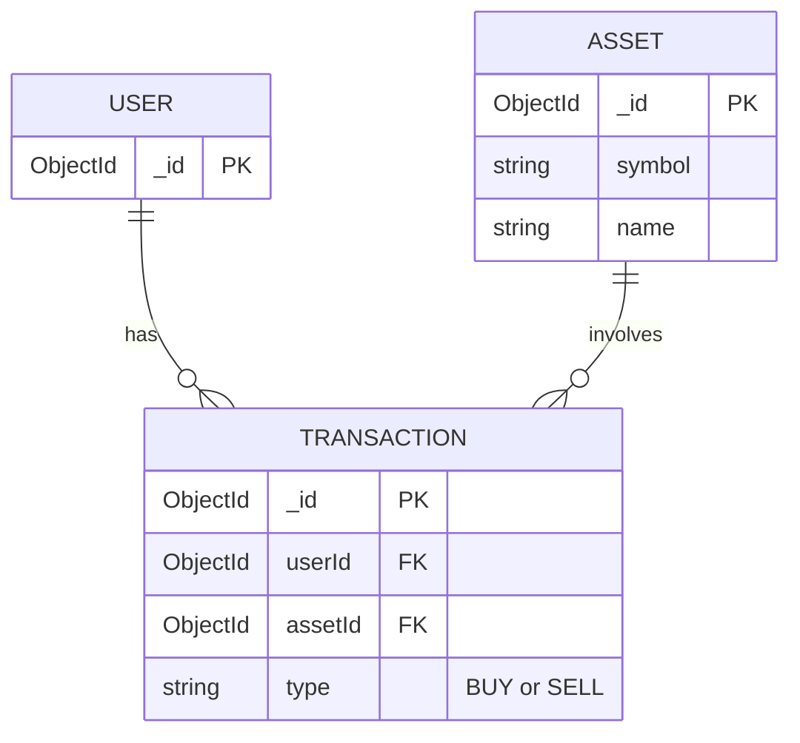

1. Project setup
[x] Initialize Git and connect GitHub
[x] Initialize Node.js project and install Express
[x] Create a working Express server and first GET endpoint
[x] Set up .gitignore and environment variables
[x] Organize the project folder structure

2. API planning & database design
[x] Define the MVP and supported transaction types
[x] Choose the data models and their relationships
[x] Create an ERD or equivalent diagram
[x] Plan REST endpoints and example JSON responses

3. MongoDB & Mongoose
[ ] Understand MongoDB collections, documents and schemas
[ ] Connect the application to MongoDB
[ ] Create the database models and relationships

4. Core REST API
[ ] Implement transaction CRUD endpoints
[ ] Add request validation and error handling
[ ] Implement filtering and sorting
[ ] Calculate portfolio holdings from transactions

5. External API communication
[ ] Understand HTTP requests between APIs
[ ] Choose a cryptocurrency price provider
[ ] Fetch and process current cryptocurrency prices
[ ] Handle external API failures

6. Portfolio & FIFO calculations
[ ] Understand and integrate Decimal.js for precise financial calculations.
[ ] Calculate acquisition costs including fees
[ ] Implement FIFO for partial and multiple sales
[ ] Calculate realized profits and losses
[ ] Add simplified German holding-period classification
[ ] Flag incomplete or inconsistent transaction histories

7. Security
[ ] Decide on authentication and authorization
[ ] Protect private endpoints
[ ] Configure CORS and rate limiting
[ ] Add appropriate security headers and safe error responses

8. Testing with Jest
[ ] Test CRUD endpoints and validation
[ ] Test FIFO calculations with known examples
[ ] Test authentication and error cases
[ ] Test external API communication with mocked responses

9. Documentation & deployment
[ ] Write README with setup instructions
[ ] Document endpoints, requests and responses
[ ] Deploy the API with HTTPS
[ ] Verify deployed endpoints and submit GitHub and live URLs

10. Optional extensions
[ ] Import Binance transactions from CSV
[ ] Detect duplicate imports
[ ] Generate annual portfolio or tax summaries

## Minimum Viable Product (MVP)

The **Crypto Portfolio API** is a REST API that allows users to track cryptocurrency transactions and calculate the current value of their portfolio.

### 1. Transaction Management

The API supports two transaction types: `BUY` and `SELL`.

Users can perform the following CRUD operations:

| Method | Endpoint | Description |
|---|---|---|
| GET | `/transactions` | Retrieve all transactions |
| GET | `/transactions/:id` | Retrieve a transaction by ID |
| POST | `/transactions` | Create a new BUY or SELL transaction |
| PATCH | `/transactions/:id` | Update an existing transaction |
| DELETE | `/transactions/:id` | Delete a transaction |

Transactions are stored persistently in **MongoDB**.

### 2. Live Cryptocurrency Prices

The API communicates with an external cryptocurrency price API to retrieve current market prices in **EUR**.

### 3. Portfolio Holdings and Valuation

The API calculates the user's cryptocurrency holdings based on recorded BUY and SELL transactions.

For each cryptocurrency, it provides:

- Total quantity currently held
- Current market price in EUR
- Current value of the holdings in EUR

The API also calculates the **total portfolio value in EUR**.

### 4. Scope

The MVP focuses on transaction management and current portfolio valuation.

The following features are planned for later development:

- FIFO cost-basis and realized profit/loss calculations
- Simplified German tax holding-period classification
- Binance CSV transaction imports

## ERD

## REST API Endpoints

### Transaction Management

| Method | Endpoint | Description |
|---|---|---|
| GET | `/transactions` | Retrieve all transactions |
| GET | `/transactions/:id` | Retrieve a transaction by ID |
| POST | `/transactions` | Create a new BUY or SELL transaction |
| PATCH | `/transactions/:id` | Update an existing transaction |
| DELETE | `/transactions/:id` | Delete a transaction |

### Live Cryptocurrency Prices

| Method | Endpoint | Description |
|---|---|---|
| GET | `/assets/:symbol/price` | Retrieve the current EUR price of a cryptocurrency |

Example: `GET /assets/BTC/price`

### Portfolio

| Method | Endpoint | Description |
|---|---|---|
| GET | `/portfolio` | Retrieve current cryptocurrency holdings and total portfolio value in EUR |

## MongoDB vs. PostgreSQL

| Feature | PostgreSQL | MongoDB |
|---|---|---|
| Database type | Relational (SQL) | Document-oriented (NoSQL) |
| Data storage | Tables | Collections |
| Individual records | Rows | Documents |
| Data structure | Columns defined by a schema | Fields in BSON documents |
| Schema | Typically predefined and enforced | Flexible; validation can be added |
| Primary key | Usually `id` | Usually `_id` |
| Relationships | Foreign keys and JOINs | References or embedded documents |
| Query language | SQL | MongoDB Query Language (MQL) |
| Transactions | Supports ACID transactions | Supports ACID transactions, including multi-document transactions |
| Node.js integration | Prisma, `pg`, etc. | Mongoose, MongoDB Node.js driver |
| Data validation | Database constraints | MongoDB schema validation and/or Mongoose validation |
| Best suited for | Structured data with complex relationships | Flexible document structures and document-oriented applications |

### Key Concepts

- **MongoDB** is the database system.
- **Mongoose** is an ODM (Object Document Mapper) for Node.js.
- **Schema:** Defines the structure and validation rules of documents in Mongoose.
- **Model:** Provides methods to interact with a MongoDB collection.
- **Collection:** A group of related documents, similar to a PostgreSQL table.
- **Document:** A single record stored in BSON format, similar to a PostgreSQL row.

### Why MongoDB for the Crypto Portfolio API?

MongoDB was chosen primarily as a learning opportunity to gain experience with a NoSQL database and Mongoose.

The project will use three main models: `User`, `Asset`, and `Transaction`, with references between related documents.